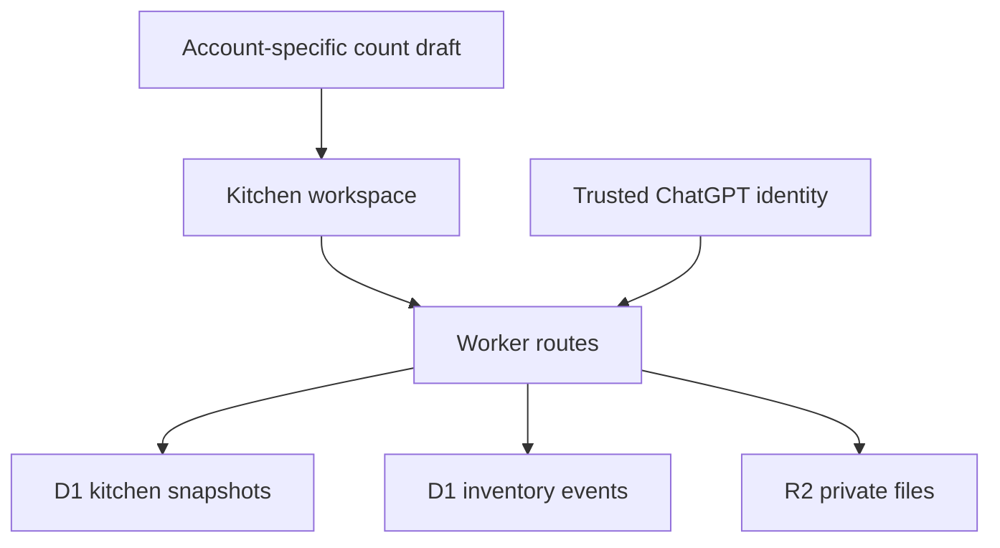

# Architecture

The hosted Mise workspace uses React and TypeScript through Vinext on
Cloudflare Workers. ChatGPT supplies identity, D1 stores current kitchen records
and inventory events, and R2 stores private imported files. The older Supabase
modules are retained separately; they are not the active storage or real-time
service for this workspace.

## Identity and boundaries

`getChatGPTUser()` reads the trusted hosted identity. Every kitchen, file and
inventory query uses that authenticated owner. A supplied owner ID cannot choose
a tenant. The stock APIs also compare an `X-Mise-Account` consistency marker to
the identity, so a tab opened under a previous sign-in cannot silently submit
its cached count to the next account. The marker never grants access.

Writes reject a mismatched Origin when present. Billing access checks run before
stock changes. Read routes and mutation responses use `Cache-Control: no-store`.
Server secrets do not enter browser bundles. The current UI exposes one kitchen
and primary location per account; staff roster records do not grant logins.

## Current state and inventory history

`kitchen_workspaces` stores a validated version-1 JSON document, revision and
update time. The snapshot contains ingredients, recipes, suppliers, prep, orders,
waste and optional budget, operations and station-target records. Old backups
remain compatible. Saves are bounded to 2 MB.

`inventory_events` stores immutable count, movement and posted-usage payloads.
Its primary key includes owner, location and event ID. A separate unique
owner/location/kind/reference key prevents a sales snapshot from being posted
again under another event ID. Source document files remain in R2, outside Git.

Every save conditionally updates the expected revision. When a stock event is
needed, a D1 batch combines that update with the event insert. The event insert
requires the random save token written by that same update. A failed insert
rolls back stock; a losing concurrent writer cannot create an orphan event.

Count requests use the same ID and canonical payload hash on retry. Replay
returns the latest snapshot without repeating the change. A different payload
under the same ID is rejected. PMIX posting also retains the report reference,
recipe quantities, units and price basis in an immutable snapshot.

## Offline count boundary

The open page saves a minimal count draft in account-specific device storage.
It includes ingredient identities, unit definitions, baseline quantities, the
expected kitchen revision and measured entries. Demo drafts use session storage
under a different key. Staff and billing records are not copied into the count.

Queueing freezes a request ID. Reconnect starts one attempt; failures keep the
draft for retry. Revision conflicts preserve measurements and require an explicit
review before a new ID is created. A changed pack definition resets incompatible
entries. Storage failure is visible and leaves an in-memory exportable draft.
There is no service worker or guarantee of launch from a closed browser offline.

## Usage and reconciliation

Current recipe quantities and measured yields translate sold units into usable
ingredient quantities. Unknown mappings or conversions block posting. Prices may
be unknown while quantities are valid. Posting requires a physical baseline
before the service period, enough stock and no later count, overlapping source
posting or unresolved manual stock change after that baseline.

Variance is a read-only comparison of physical opening/closing counts, recorded
receipts, logged waste and recipe usage. The report must cover the exact service
interval. Posted quantities take precedence over a new estimate from edited
recipes. Dollar differences use the closing count's saved unit cost. Manual
adjustments are flagged and never added again as receipts.

History uses keyset pagination, 25 events per page. Period reviews are bounded
to 2,000 movement/usage events and 4 MB. The current-state JSON backup and ledger
export are separate. A restore does not rewrite native history or reinterpret
old received orders as new deliveries.

## Integrations and releases

Stripe subscription code is implemented but merchant credentials and end-to-end
webhook delivery are not configured. The separate relay design accounts for the
private Site's service authentication. OCR, direct POS delivery, shared teams,
live 86 status and location administration are not active integrations. Their
acceptance gates are in the [integration backlog](integration-roadmap.md).

Schema-only migrations are append-only under `drizzle/`; hosted publication
applies them. The Sites helper builds, commits source and packages the Worker.
GitHub receives the same release tree through its own clean history, with no
runtime records or private source history. The current audience stays private.

For retained Next.js/Supabase design notes, see the
[legacy architecture](legacy-supabase-architecture.md). Those modules require
separate configuration and validation.
